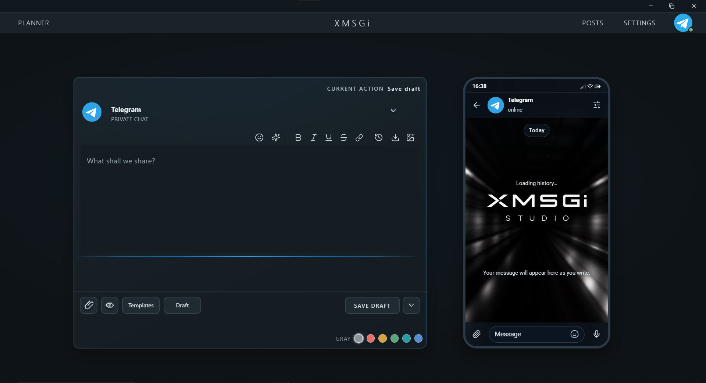

# XMSGi Studio

Write, schedule, and manage Telegram posts from your account.

## Download

[Download XMSGi Studio v1.4.3](https://github.com/molodoy01/XMSGi-Studio-1.4.3/releases/tag/v1.4.3) for Windows, Linux, and macOS.

## Repository

- `app/` — desktop app and tests
- `docs/` — documentation
- `screenshots/` — app screenshots

## License

MIT. See [LICENSE](LICENSE).
